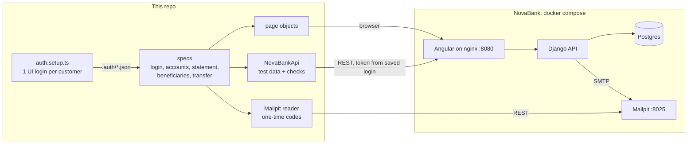

# Playwright TS SDET Framework

[](https://github.com/HrishiPurandare/playwright-ts-sdet-framework/actions/workflows/playwright-ci.yml)


[](LICENSE)

End-to-end UI tests for **[NovaBank](https://github.com/HrishiPurandare/novabank)**, a fictional UAE bank (Angular + Django + Postgres) built to be tested. The suite drives a real browser against the real stack in Docker: logins, statements, beneficiaries with emailed one-time codes, and money transfers, including what happens when the network drops a reply after the money has moved.

It's not a demo-site suite: the app has real business rules (limits, idempotency, IBAN check digits, owner-only data), so the tests have real things to prove.

## At a glance

| | |
|---|---|
| Tests | 38 in Chromium, 34 in Firefox (the 4 real-login tests run once), plus 3 setup logins: 75 per run |
| Run time | about 1 minute locally, 4 workers |
| Stability | 204 test runs in a row (`--repeat-each=3`, 4 workers) with no flaky test |
| Tested the tests | 4 bugs planted in the app: 3 caught, 1 couldn't be (see [LEARN §8](LEARN.md#8-tested-the-tests)) |
| Bugs found in the app | 2, both fixed in NovaBank 1.2.0 (kept as `test.fail` until then, see below) |

## How it fits together



```
src/
  config/env.ts          BASE_URL, MAILPIT_URL (http(s) only)
  data/                  customers (personas), IBAN generator, money in fils (BigInt)
  api/                   NovaBankApi (REST client), Mailpit OTP reader, API types
  pages/                 one page object per screen + the app shell
  fixtures/index.ts      `customer` option, saved login, api, confirmedPayee, cleanup
tests/
  auth.setup.ts          logs Sara, Omar and Lina in once, saves their storage state
  *.spec.ts              one file per screen
```

## Run it

Start the bank (in a checkout of [novabank](https://github.com/HrishiPurandare/novabank), see its README), then:

```bash
npm ci && npx playwright install chromium firefox
npx playwright test
npx playwright show-report
```

`BASE_URL` and `MAILPIT_URL` point it somewhere else (defaults: `http://localhost:8080`, `http://localhost:8025`). `npm run test:headed` watches it in one browser.

## What's covered

| Screen | What the tests prove |
|---|---|
| Login | real login per persona; wrong password; empty/invalid fields never reach the server; deep link survives the login detour; `returnUrl` can't leave the site; logout; expired session (mocked 401s) |
| Accounts | every balance matches the API to the fils; the total is the exact BigInt sum; only the frozen account is marked; one-account customer |
| Statement | count matches the API; **every running balance follows from the row below it**; filters live in the URL and survive reload; paging keeps filters; search; reversed dates refused in the browser; page past the end; another customer's account looks exactly like a missing one |
| Beneficiaries | add with a pasted lower-case spaced IBAN → **code read from the real email in Mailpit** → confirmed → "Send money" prefills the transfer; wrong code → tries left; bad shape caught in the browser; bad check digit caught by the server; duplicate IBAN; remove with confirmation |
| Transfers | review → confirm → exactly one debit and one credit (checked through the API); statement shows it; double click sends one request; Edit keeps the form; **reply lost after the money moved → retry reuses the Idempotency-Key and pays once**; a clear refusal gets a new key; AED 10,000 new-beneficiary limit; client-side amount checks |

## Bugs the suite found

1. **Dashboard says "1 accounts"** for a customer with one account. Kept as a `test.fail()` (green while the bug existed); it turned red the day NovaBank 1.2.0 fixed it, and the marker was removed.
2. **An expired session loses the customer's place.** Opening `/beneficiaries` with an expired login sends you to `/login?returnUrl=/`, so after logging in you land on Accounts. The app's first call (`/api/auth/me/`) fails before the router has finished navigating, and the interceptor read `router.url` too early. It reproduced about 15 runs in 16, so the `test.fail()` marker itself was flaky. Fixed in NovaBank 1.2.0 (the interceptor uses the navigation in progress, or the address the user opened); 80 repeat runs green since.
3. **The bank's own smoke test had a hidden precondition.** It tried AED 10,000.01 from the first account and expected the limit error; once that account held less than AED 10,000, the bank (correctly) said "insufficient funds" first. Fixed in novabank: pick the richest account and state the precondition. This suite's limit test does the same.

## Design decisions

- **One UI login per customer, then saved storage state.** The bank allows 10 logins a minute. A suite that logs in per test trips the limit in seconds; this one logs in 3 times per run plus 4 real-login tests in Chromium only.
- **The API client reuses the saved token** instead of logging in. Test data goes in through the API (fast, exact); what the customer sees is checked in the browser.
- **Personas, not admin/user roles.** In a bank the "roles" that matter are customer situations: Sara (two accounts, sends money), Omar (one account, adds beneficiaries), Lina (a frozen account; nobody moves her money, so her balances are safe to assert while other workers run).
- **Parallel-safe by construction.** Every beneficiary has a unique name and a computed valid IBAN, every transfer a unique remark; tests check *their own* rows, never "the balance is now X".
- **Network mocking only where reality can't be arranged.** The lost reply uses `route.fetch()` (the real bank moves the money) then `route.abort()`; the expired session mocks 401s so the shared refresh token is never rotated.
- **Money is never a float.** Amounts are compared as integer fils (`BigInt`), so a one-fils error fails.
- **The CI tests a released bank** (`v1.2.0` by default; any ref through "Run workflow"), so a red build means the tests changed, not the app.

## CI

`.github/workflows/playwright-ci.yml` checks out novabank, starts it with Docker Compose, type-checks, runs the suite in Chromium and Firefox, and uploads the HTML report (with traces, screenshots and videos of any failure).

## Roadmap

- [x] Retarget from a demo app to NovaBank: personas with saved logins, page objects, API-seeded data, Mailpit, network mocking
- [ ] Accessibility checks with axe-core on every screen
- [ ] Visual regression for the dashboard and statement
- [ ] ESLint + Prettier, sharding with a merged report, report on GitHub Pages
- [ ] Mobile viewport project

## Learning notes

[LEARN.md](LEARN.md) explains the framework part by part, with "break it" exercises and interview questions.
